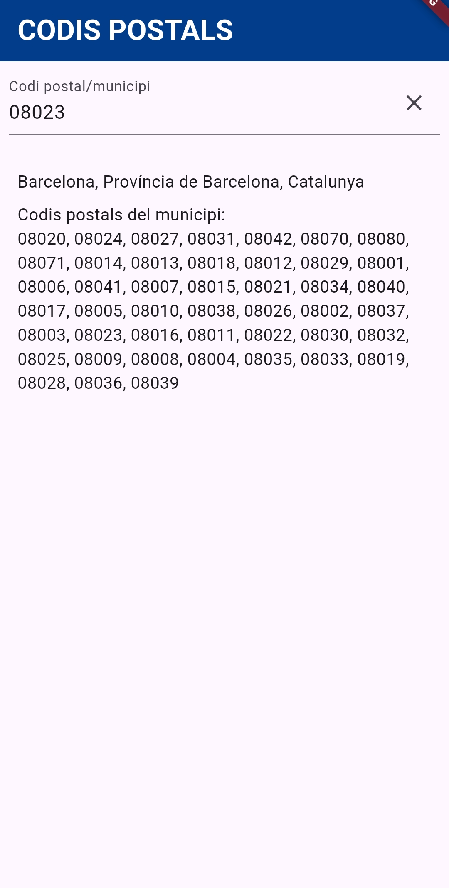
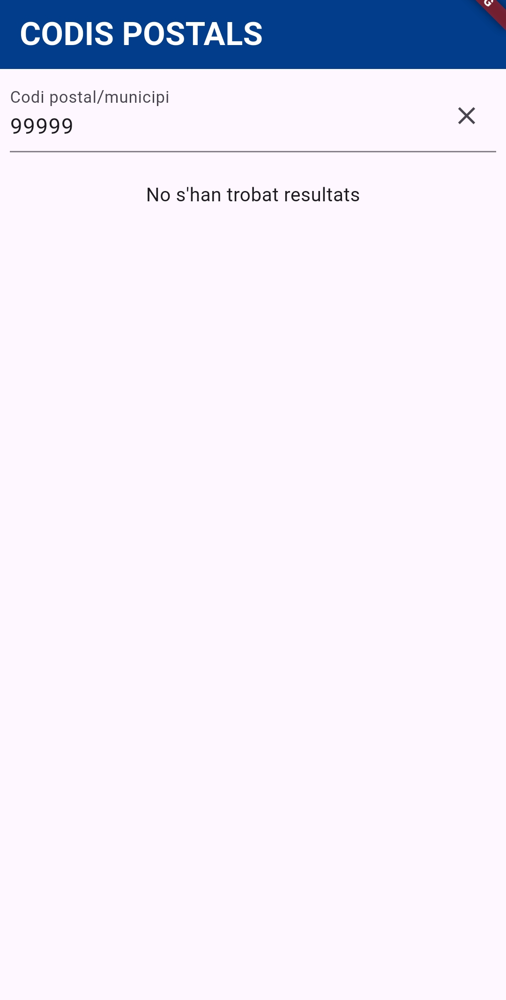
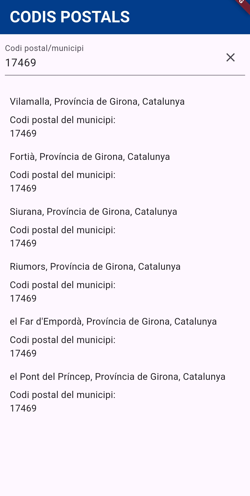
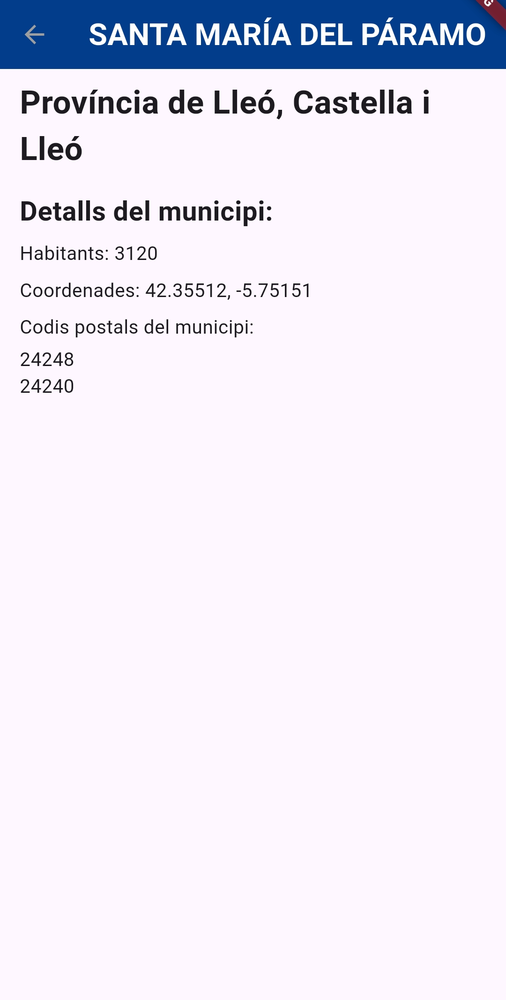
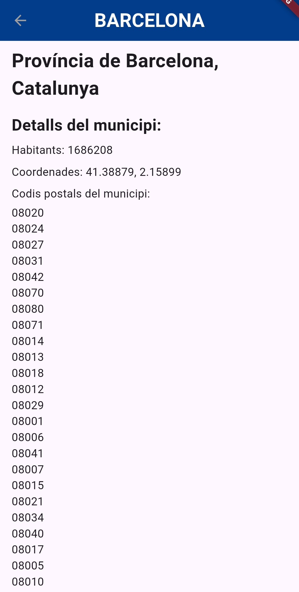

# Codis postals

Aplicació Flutter per consultar codis postals i municipis a partir de l'API de geocodificació d'[Open-Meteo](https://open-meteo.com/).

## Funcionalitats

- **Base:** cerca per codi postal o nom de municipi amb llistat de resultats, missatge quan no hi ha resultats i missatge d'error quan falla la connexió.
- **Ampliació:** pantalla de detall de cada municipi (habitants, coordenades i tots els codis postals).
- **Repte:** no realitzat.

## Captures de pantalla

### Pantalla de cerca

| Error                                                                             | Resultats (Barcelona)                                                                       |
| --------------------------------------------------------------------------------- | ------------------------------------------------------------------------------------------- |
|  |                 |
| **Sense resultats**                                                               | **Múltiples municipis**                                                                     |
|    |  |

### Pantalla de detall (ampliació)

| Nom llarg                                                                              | Barcelona                                                                 |
| -------------------------------------------------------------------------------------- | ------------------------------------------------------------------------- |
|  |  |

## Reflexió

Ha anat bé en general. Crear el servei i el model m'ha sortit bé, tot i que els vaig haver de modificar. Si hagués mirat les pistes abans, hauria guanyat temps.

El que més m'ha costat han estat els paddings a la UI en la primera pantalla. Encara són un repte per a mi, entre columnes paddings... tot i que he aplicat poc temps a la interfície.

Al principi no distingia entre "no hi ha resultats" i "error". Quan la cerca fallava, el `try/catch` retornava una resposta buida i la pantalla mostrava "No s'han trobat resultats". Ho vaig resoldre fent servir `rethrow`, perquè l'error arribés als condicionals del `FutureBuilder`.

## Dades

Les dades provenen d'[Open-Meteo](https://open-meteo.com/), amb llicència [CC BY 4.0](https://creativecommons.org/licenses/by/4.0/), originàries de [GeoNames](https://www.geonames.org/).
